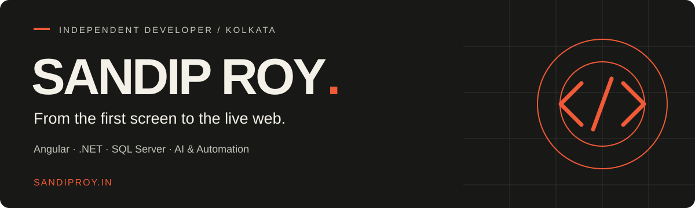

  <a href="https://www.sandiproy.in/"><strong>Portfolio ↗</strong></a> &nbsp; · &nbsp;
  <a href="https://www.linkedin.com/in/sandip-roy1992">LinkedIn</a> &nbsp; · &nbsp;
  <a href="mailto:contact@sandiproy.in">Let’s talk</a>

### Hi, I’m Sandip.

I’m a freelance full stack developer based in **Kolkata, India**, with **8+ years of experience**. I build web applications from the interface through the API, database, and hosting — with a growing interest in practical AI and automation.

I like turning ideas into things people can actually use. My work spans commerce, music, and cultural experiences, with attention to both the experience on screen and the systems behind it.

### What I work with

| Frontend | Backend & data | AI & delivery |
| :--- | :--- | :--- |
| Angular · React · responsive interfaces | .NET · REST APIs · SQL Server | Python · machine learning · automation |
| WordPress | Third-party integrations | Web hosting & deployment |

### Selected work

Full development and hosting on all four projects below, using **Angular, .NET APIs, and SQL Server**.

<table>
  <tr>
    <td width="50%" valign="top">
      
      <h3><a href="https://thefishhawkjig.com/">The FishHawk Jig ↗</a></h3>
      
A fishing brand brought to life on the web.

      
COMMERCE · DEVELOPMENT & HOSTING

    </td>
    <td width="50%" valign="top">
      
      <h3><a href="https://fittantra.co/">FitTantra ↗</a></h3>
      
A digital storefront for health and performance.

      
COMMERCE · DEVELOPMENT & HOSTING

    </td>
  </tr>
  <tr>
    <td width="50%" valign="top">
      
      <h3><a href="https://durgaelo.com/">Durga Elo ↗</a></h3>
      
A music and culture experience celebrating Durga Puja.

      
MUSIC & CULTURE · DEVELOPMENT & HOSTING

    </td>
    <td width="50%" valign="top">
      
      <h3><a href="https://christmasonair.com/">Christmas on Air ↗</a></h3>
      
A seasonal web experience for tuning into Christmas.

      
MUSIC & SEASONAL · DEVELOPMENT & HOSTING

    </td>
  </tr>
</table>

### From idea to launch

- **Websites & web apps** — responsive interfaces built with Angular, React, and WordPress.
- **APIs & databases** — .NET services, SQL Server, and third-party integrations.
- **AI & automation** — Python and practical workflow tools.
- **Hosting & delivery** — connecting the pieces and getting the application live.

### Have a project in mind?

Explore [my portfolio](https://www.sandiproy.in/) or reach me at **[contact@sandiproy.in](mailto:contact@sandiproy.in)**.

---

Built in Kolkata. Open to the world.

